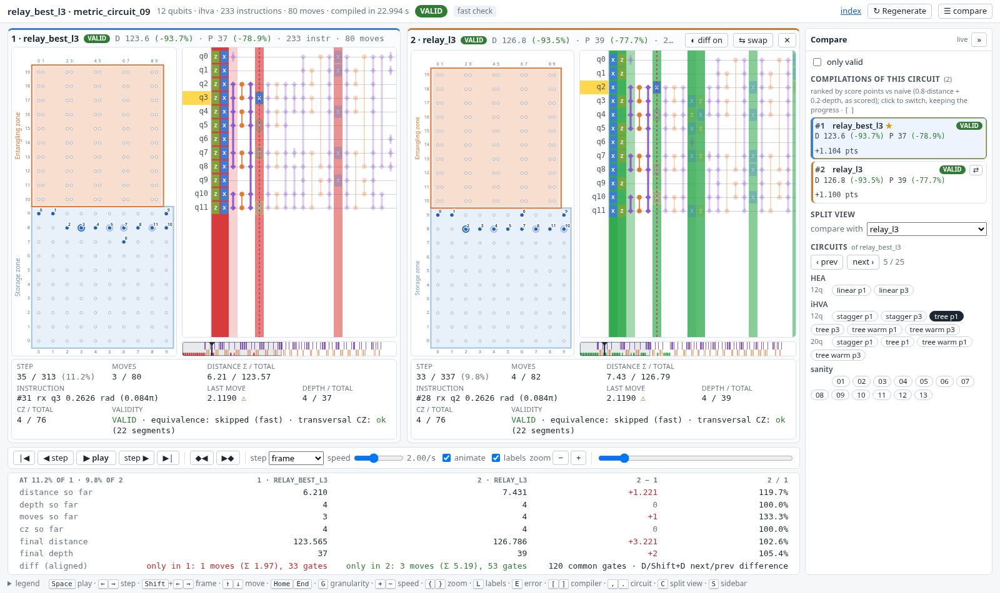

# Visualiser (`bench/viz.py`)

Step-by-step view of what a compiler does: the compiled circuit (wire diagram) and the atom
positions on the zoned machine (2D, physical coordinates, styled like Fig. 1/2 of the brief), in
sync, with a cursor you can play, step, scrub or click.

Everything shown comes from the **official validator**: the circuit is compiled with
`run_compiler(reference, compiler, network=False)` (sandboxed child process, like `bench.py`), and
replayed with `verify_movement(compiled, loading)`. Atom positions, per-move distances, parallel
steps and spacing warnings are the validator's `MoveRecord` trace; the final totals are
`compute_metrics(...)`, so they equal `bench.py`'s numbers. The transversal-CZ check is
`bench.physics_check`. An invalid compilation is still rendered: the validator's replay is re-run
without raising (it skips illegal instructions), every violation is marked, and the first error is
shown in a red banner with a button that jumps to it.

## Usage

Run from the repo root (inside a worktree use `/home/hackathon/challenge/.venv/bin/python`):

```sh
# one page (bench label or any .qasm file); also refreshes viz/index.html
python bench/viz.py page compilers/<idea>/compiler.py --circuit metric_circuit_07 [--mode full]

# every circuit of a set, 2 workers; prints bench-style lines and the score. Like bench.py, the
# metric set defaults to the 20 circuits the v5 leaderboard scores (--full-set: all 36);
# --set all = those + the 13 sanity circuits
python bench/viz.py all compilers/<idea>/compiler.py [--set metric|sanity|all] [--full-set] [--filter 50q] [--jobs 2]

python bench/viz.py index        # rebuild viz/index.html + viz/manifest.json, refresh page snapshots
python bench/viz.py rewrap       # re-embed existing pages into the current template (no recompile)
python bench/viz.py serve        # http://<host>:9000/ serving viz/ (default host 0.0.0.0)
```

- Output: `viz/<name>/<label>.html` (one self-contained page, no external assets) plus
  `viz/<name>/<label>.json` (sidecar with metrics, used by the index). `viz/` is committed so the pages can be opened straight from the repo.
  `--out DIR` changes the output directory for every subcommand.
- `<name>`: the idea folder for compilers under `compilers/` of this checkout or of the main repo
  (`naive`, `gates`), `<worktree>-<idea>` for `/home/hackathon/challenge-wt/<wt>/compilers/<idea>/`
  (`rectbatch-rectbatch`), `scratch-<folder>` otherwise; `--name` overrides. Pages of the same
  circuit label under different names are what the comparison sidebar lists.
- `viz/manifest.json`: every compiler × circuit page with its metrics, validity and path; rewritten
  by `page`, `all`, `index`, `rewrap` and the server's regenerate endpoint. Every page also embeds a
  snapshot of the part it needs (its circuit's compilations and its compiler's circuits): `page`
  refreshes the snapshots of the same circuit and compiler, `all`/`index`/`rewrap` refresh all.
- Excluded compilers: `EXCLUDED = {"portfolio"}` in `bench/viz.py` (portfolio is the per-circuit best
  of the others, so its pages add nothing). `page` and `all` refuse them unless `--force`, the
  regenerate endpoint refuses them (403), and the index, `manifest.json`, the comparison sidebar and
  the split-view picker skip them even if their pages exist on disk (also `<worktree>-portfolio`).
- `--mode fast` (default) = compile + replay + metrics + zone-span check (ADR 0010) + transversal-CZ
  check (ADR 0007), like `bench.py`; `--mode full` adds the official equivalence check. The index
  score and the sidebar's ranking weights use the v5 leaderboard set (naive totals 163 364.3 /
  13 364).
- The pages work from `file://` too; only the ↻ Regenerate button needs the server.
- `serve` exposes `POST /api/regenerate` `{"compiler": <abs path>, "circuit": <bench label>,
  "mode": "fast"|"full"}`, used by the page's ↻ button: it recompiles that circuit and rebuilds
  the page. Only `*.py` files whose resolved path (symlinks followed) lies under
  `/home/hackathon/challenge/compilers/` or `/home/hackathon/challenge-wt/<wt>/compilers/` are
  accepted, and only known bench labels; one regeneration at a time (409 when busy).
  `GET /api/ping` tells the page that the API exists.
- Smoke checks (dev-only packages `playwright`, `esprima`; see `pyproject.toml`):
  `python bench/viz_check.py viz/naive/metric_circuit_01.html ...` (static + headless Chromium),
  `python bench/viz_check.py --compare viz/<name> results/runs/<run>.json|naive` (sidecar metrics
  vs a bench run) and `python bench/viz_check.py --nav http://127.0.0.1:9123 [--nav-page
  gates/metric_circuit_07.html]` (sidebar, shortcuts and split view on a served `viz/`). Chromium needs `python -m playwright install chromium`; on this machine its
  missing shared libraries are in `~/.cache/viz-chromium-libs/lib` (conda-forge, via micromamba),
  so prefix `LD_LIBRARY_PATH=/home/hackathon/.cache/viz-chromium-libs/lib`.

## The page

Left: **atom view** in physical coordinates (storage at the bottom, entangling zone on top, as in
the brief's Fig. 1/2), with row/column grid labels. Right: **circuit view** (one wire per qubit,
ASAP columns, horizontally scrollable), an **overview strip** of the whole instruction stream,
the controls and the live stats.

| control | key |
|---|---|
| play / pause | `Space` |
| step back / forward (current granularity) | `←` / `→` |
| step one frame back / forward | `Shift`+`←` / `→` |
| previous / next move (lands on its step A) | `↑` / `↓` |
| start (initial loading) / end | `Home` / `End` |
| granularity: instruction ↔ frame | `G` |
| speed ×1.5 / ÷1.5 (0.25–60 steps/s) | `+` / `−` |
| circuit zoom | `}` / `{` (or Ctrl+wheel) |
| previous / next compiler (same circuit, progress kept) | `[` / `]` |
| previous / next circuit (same compiler) | `,` / `.` |
| split view on/off (on = best other valid compilation) | `C` |
| comparison sidebar on/off | `S` |
| atom labels on/off | `L` |
| jump to the first error | `E` |
| jump anywhere | click the circuit, the overview strip, or drag the scrubber |

- **Steps.** The cursor walks *display steps*: a gate (or barrier, measurement, illegal move) is one
  step, a replayed `move` is **two**: step **A (origin)**, atoms still at their old positions, the
  picked-up rectangle (picked rows × picked cols, one contiguous area, dropped empty lines
  included) shaded green and the atoms that will move haloed; and step **B (target)**, atoms at
  their new positions, the target rectangle (bounding box of `new_rows` × `new_cols`) in magenta
  with every target line inside it dashed (spread or squeezed targets show their gaps), the moved
  atoms haloed and dashed ghosts + arrows at their old positions. Going A → B (playing or stepping
  forward) slides the atoms from origin to target while the green rectangle fades into the
  magenta one; stepping back B → A slides them back. Jumps are instant. Position 0 is the initial
  loading. The step counter, scrubber, `#p=` progress and the split view all count a move as two
  steps; the wire diagram points both steps at the move's column, with an **A**/**B** tag on the
  cursor.
- A **frame** is a maximal block of consecutive gates, or one half of a move: frame mode steps a
  gate block, then the move's A, then its B.
- Stats: step and frame, the current instruction (angles in rad and multiples of π; `· A origin
  (pending)` / `· B target` on moves), moves m/M, the move's distance (at step A as "pending move:
  distance d", not yet counted; it is added to the move counter and Σ distance at step B), the last
  move's distance between moves, Σ distance so far vs this circuit's total and the
  naive compiler's (black tick on the bar; Δ % = total/naive − 1, negative is better), depth so
  far (moves and barriers stripped, as scored) vs total and naive, CZ count, spacing warnings,
  parallel step, validity (validator replay, equivalence status, transversal-CZ check), and the
  final totals from `compute_metrics()`.
- Hovering a circuit glyph shows its details; for moves, the qubits, `rows→new_rows`,
  `cols→new_cols`, distance, parallel step and spacing warnings.

Legend (also on the page, "legend" in the footer):

| atom view | circuit view |
|---|---|
| hollow gray circle: trap site (entangling traps are doublets 0.3 apart) | blue box "X": `rx` |
| filled blue dot: atom (label = qubit index) | green box "Z": `rz` |
| blue ring: `rx` on that atom | two orange dots + line: `cz` |
| green ring + dashed crosshair: `rz` (targeted) | purple bar + diamonds: `move` (diamonds on moved qubits) |
| orange overlapping discs: `cz` pair | gray "M": `measure`; dashed gray line: `barrier` |
| step A: green rectangle = picked rows × picked cols; green halo = atoms that move | yellow background: current instruction (pale: rest of its frame) |
| step B: magenta rectangle = target bounding box, dashed magenta = target lines; magenta halo, dashed ghosts + arrows | A / B tag on the cursor: move step |
| red ✕: instruction that violates a rule | faded glyphs: not executed yet; red outline/fill: violation/error |
| red dashed ring: under-pulsed pair of a failing CZ segment | red dashed line: cursor |

In instruction mode, the gates of the current frame other than the current one are drawn faintly
in the atom view, so you can see the whole parallel block around the cursor.

## Comparing compilers

**Sidebar** (right, `S` or "☰ compare" toggles it):

- *Compilations of this circuit*: every compiler with a page for this circuit label, ranked by the
  score points it earns on this circuit vs naive,
  `100 · (0.8 · (D_naive − D) / 163 364.3 + 0.2 · (P_naive − P) / 13 364)` (the leaderboard's
  weighting; the totals are the naive compiler's over the v5 leaderboard set), with the raw distance and depth and their
  % vs naive, a validity badge, ★ for the best. Invalid compilations are listed last, unranked.
  Click a row to open that compiler's page **at the same relative progress** (fraction of the
  step list), with play state, granularity, speed and split view carried over; `⇄` opens it
  in the split view instead.
- *Split view*: "compare with…" picker (or `C`).
- *Circuits* of the current compiler grouped by family (HEA / iHVA / QAOA / sanity) and size, with
  prev/next (`,` / `.`; the progress restarts at 0).
- "only valid" hides invalid compilations and circuits (the current page always stays listed).
- The list comes from `../manifest.json` when the page is served over http ("live": compilers
  generated after this page appear without rebuilding it) and from the embedded snapshot under
  `file://` ("snapshot").

**Split view** (off by default): side 1 = this page's compilation (left), side 2 = the picked one
(right; sides are numbered because A/B name the move steps), each with its atom view, a compact
circuit strip, overview and stats; one shared control bar. The scrubber, steps and play run on
side 1, and side 2 follows at the same relative step progress (its moves slide too when it goes
from a move's A to its B). Clicking side 2's circuit or overview jumps it and puts side 1 at the
same progress. Below: a difference table (distance, depth, moves, CZ so far and final, 2 − 1 and
2 / 1). "⇆ swap" opens side 2's page with this one on the right; "✕" or `C` closes it. Side 2's
data is fetched from its page over http; under `file://` the browser blocks that, and the split
view shows a message with a link to its page instead.

**Diff mode** (split view, on by default; "◐ diff on/off" button in side 2's header, `diff=0` in the
hash turns it off): the two compilations are aligned instead of followed by relative progress.
The CZ gates (the pulse structure) are aligned with Myers' diff; they define the *equivalent
states* and the position maps. Moves (exact (qubit, from, to) sets) are matched as multisets inside
each pair of aligned CZ segments; `rx`/`rz`/measurements are aligned per qubit (their per-qubit
order is what matters, not where in the global stream a compiler emitted them).
Instructions that exist only on side 1 are tinted **red** in its circuit strip (ticks in its
overview), those only on side 2 **green**. Side 2 follows side 1 through the alignment (exact on
common instructions, interpolated inside differing runs); clicking an instruction on either side
jumps the other one to the equivalent state. `D` / `Shift`+`D`: next / previous run of differences
(on side 1). The difference table adds a row with the moves (count and Σ distance) and gates only
in 1 / only in 2, and the number of common CZ gates. Sequences whose CZs differ in more than 6000
edits fall back to relative progress ("diff (too different)").



**URL hash** (kept when switching pages, updated as you go): `p` progress 0–1, `play=1`,
`gran=inst` (instruction steps; default: frame), `sp` speed, `cmp=<name>` split view, `side=0` sidebar hidden, `ov=1` only valid,
`lbl=0` atom labels off, `diff=0` diff mode off. Example: `gates/metric_circuit_36.html#cmp=zonedwell&p=0.25`.

## Handoff: pages for the relay family (diff mode)

Generated pages are not committed (`viz/` is gitignored); build them on the server from the code:

```sh
# the 20 scored circuits for the current leader and the compilers it is compared with
for c in relay_best_l3 relay_l3 relay solo; do
  python bench/viz.py all compilers/$c/compiler.py --set metric --jobs 4
done
python bench/viz.py rewrap          # re-embed every existing page into the current template
python bench/viz.py serve           # then open e.g. relay_best_l3/metric_circuit_22.html#cmp=relay
```

Useful pairs for the diff view: `relay_best_l3` vs `relay` (everything this branch added),
`relay_l3` vs `relay` (only the peephole pass: same gates, so the diff is moves only),
`relay_best_l3` vs `relay_l3` (Codex's solo work + variants + rollout). 50q pages take a few
minutes each to compile (relay_best_l3 up to ~200 s per circuit).

## Invalid compilations

- `compile` (the compiler raised, timed out or returned bad output): banner with the message;
  no circuit or atoms.
- `loading` (invalid initial loading): the instructions are shown, without a replay.
- `movement` (illegal move, gate outside its zone, CZ off a pair): the validator's replay is
  re-run without raising (`ValidationArchitecture._replay`, which skips illegal instructions as
  the validator does) so the page renders the whole circuit; every violation is outlined red,
  the first one is the banner's jump target, and totals are marked *partial*. Illegal moves are
  not applied, exactly like the validator.
- `physics` (transversal CZ, ADR 0007): official metrics are kept; the banner jumps to the last
  instruction of the faulty segment and the under-pulsed pairs are ringed in red.
- `zonespan` (ADR 0010: a multi-row move whose picked or target rows span both zones): official
  metrics kept, the banner jumps to the move.
- `equivalence` (`--mode full` only): banner with the QCEC / interaction-pair message.
- Validator v5 violations such as the idle rule (`Instructions a-b …: qubits … sit in that zone
  without taking part in a two-qubit gate`) are `movement` errors; the jump goes to instruction a.

## Limitations

- Sizes: 50-qubit p=3 pages are ~0.5–0.9 MB (hubstream … naive; the manifest snapshot adds ~16 KB); the 70-qubit sanity circuit
  `sample_circuit_13` (naive: 140 k instructions, 40 k moves) is ~11 MB and takes ~25 s to build,
  but loads in < 1 s and stays responsive. Numbers are compacted (physical coordinates rounded
  to 4 decimals, angles to 5); move distances are stored unrounded.
- Positions are drawn only at sites (start/end of each move); the straight-line interpolation
  during the animation is illustrative, not the validator's path model (it doesn't model AOD
  ordering constraints or the parallel-step grouping beyond showing the step number).
- The circuit view's ASAP columns put a move or barrier across the whole span of its qubits'
  wires, so it shows the instruction order faithfully but is not the scored depth (which strips
  moves). The scored depth is the "depth so far" stat.
- The regenerate endpoint runs the compiler on the server machine; keep the server on a trusted
  network.
- Progress is matched by instruction fraction, not by "the same logical gate": two compilers at 42 %
  are generally at different points of the algorithm. The difference table is a guide, not a
  gate-by-gate alignment.
- The split view needs http; under `file://` only the sidebar (from the snapshot) works.
- `rewrap` reuses the embedded data; after changing `bench/viz.py`'s data extraction, rebuild
  with `page`/`all` instead.

## Page data format (contract between `bench/viz.py` and `bench/viz_page.html`)

`bench/viz.py` reads the template `bench/viz_page.html`, replaces the single placeholder line
`<script id="viz-data" type="application/json">__VIZ_DATA__</script>` content `__VIZ_DATA__` with
`json.dumps(data, separators=(",", ":"))` in which every `</` is escaped as `<\/`, and writes one
self-contained HTML file. The page's script reads it with
`JSON.parse(document.getElementById("viz-data").textContent)`.

All coordinates called *physical* are the validator's physical coordinates (`physical()` in
`vendor/pushquantum_validator/_validation.py`): storage `(x, y)` = `(col, row)`; entangling
`x = 2*(col//2) + 0.3*(col%2)`, `y = row`. y grows **upwards** (storage at the bottom, entangling on
top, as in the brief). Physical numbers are rounded to 4 decimals. *Sites* are integer grid
`(x, y)` = (col, row) as used by moves.

```jsonc
{
  "version": 1,
  "meta": {
    "name": "naive",                    // page/compiler name (folder in viz/)
    "compiler": "/abs/path/compilers/naive/compiler.py",
    "circuit": "metric_circuit_07",     // bench label, or the qasm file stem for other files
    "qasm": "metric_benchmarks/hea/....qasm",  // path relative to vendor/pushquantum_validator, or absolute
    "family": "hea",                    // hea | ihva | qaoa | sanity | other
    "num_qubits": 12, "num_clbits": 12,
    "generated": "2026-11-21T15:00:00Z",
    "compile_s": 1.23,
    "mode": "fast"                      // fast | full (full = official equivalence check was run)
  },
  "geometry": {
    "zones": [                          // spec order; physical bounding box of the trap sites
      {"name": "storage", "ops": ["rx","rz"], "x0": 0, "x1": 9, "y0": 0, "y1": 9,
       "px0": 0.0, "px1": 9.0, "py0": 0.0, "py1": 9.0, "paired": false},
      {"name": "entangling", "ops": ["cz","rzz"], "x0": 0, "x1": 9, "y0": 10, "y1": 19,
       "px0": 0.0, "px1": 8.3, "py0": 10.0, "py1": 19.0, "paired": true}
    ],
    "traps": [[0.0, 0.0, 0, 0, 0], ...],  // every site of every zone: [px, py, zone_index, col, row]
    "bounds": [xmin, ymin, xmax, ymax]   // physical bounding box over all traps
  },
  "loading": [[px, py, col, row], ...],  // per qubit (index = qubit); null if no compiled output
  "ops": ["rx","rz","cz","move","measure","barrier"],   // name table; other names appended
  "inst": {                             // one entry per instruction of compiled.data, in order
    "op":  [0, 1, 2, 3, ...],           // index into "ops"
    "qs":  [[0], [3], [2,5], [2,5], ...],  // qubit indices of the instruction
    "par": [1.5708, -0.7854, null, ...],   // first parameter (rad, 5 decimals) for rx/rz, else null
    "col": [0, 0, 1, 2, ...],           // ASAP column in the wire diagram (see below)
    "depth": [1, 1, 2, 2, ...],         // depth of compiled.data[:i+1] with moves and barriers removed
    "mv":  [-1, -1, -1, 0, ...]         // index into "moves" for a replayed move instruction, else -1
  },
  "moves": [                            // the validator's trace, one per *replayed* move, in order
    {"i": 3,                            // instruction index
     "q": [2, 5],                       // moved qubits (MoveRecord.qubits)
     "f": [px, py, px, py],             // physical positions before the move, aligned with q
     "t": [px, py, px, py],             // physical positions after the move, aligned with q
     "ts": [x, y, x, y],                // target sites after the move, aligned with q
     "d": 10.0123,                      // MoveRecord.distance (full precision float)
     "s": 3,                            // MoveRecord.step (parallel step, 0-based)
     "w": [0],                          // indices into "warnings" (spacing warnings of this move)
     "rows": [5], "cols": [2, 3], "nrows": [10], "ncols": [2, 3],  // raw move params
     "br": [[5.0, 10.0]],               // AOD row bands: [physical y before, after] per used row line
     "bc": [[2.0, 2.0], [3.0, 2.3]],    // AOD col bands: [physical x before, after] per used col line
     "rm": [[5, 10]], "cm": [[2, 2], [3, 3]]  // line map [picked, target] after dropping empty lines (kept for tooling; not drawn)
    }
  ],
  "warnings": ["Target cols ... not evenly spaced ...", ...],  // unique spacing-warning texts
  "violations": [{"i": 17, "kind": "pair", "msg": "Instruction 17 (cz on [1, 4]): ..."}],
  "error": null,                        // or {"stage": "...", "msg": "...", "i": 17 | null}
                                        // stage: compile | loading | movement | physics | equivalence | harness
  "totals": {                           // compute_metrics() when the replay passed; else partial, from the trace
    "num_moves": 20, "move_steps": 18, "move_distance": 123.456789, "move_time": 130.1,
    "depth": 45, "num_operations": 80, "spacing_warnings": 0, "cz": 30, "partial": false
  },
  "naive": {"move_distance": 244.1, "depth": 60, "num_moves": 40, ...} ,  // naive_baseline.json metrics or null
  "equivalence": "skipped (fast)",      // or the bench-style status string, or "FAILED: ..."
  "physics": {"ok": true, "segments": 10, "msg": null},
  "regen": {"compiler": "/abs/path/compiler.py", "circuit": "metric_circuit_07"}
}
```

ASAP column: per instruction, `span` = all wires from min to max of its qubits (a single-qubit
gate spans one wire; a move or barrier spans min..max of its qubits). `col = max(next_free[w] for w
in span)`, then `next_free[w] = col + 1` for every w in span. Instructions with no qubits get
`max(next_free)`.

Depth: qiskit's `depth()` of the stripped circuit, computed incrementally over qubits **and clbits**:
for every instruction that is not `move`/`barrier`, `lvl = 1 + max(level[b] for b in its qubits and
clbits)` (0 if none), all its bits get `lvl`, running depth = max so far. Moves and barriers keep the
running depth. The last value equals `strip_moves(compiled).depth()`.

### Manifest (`viz/manifest.json`, and the page's `viz-manifest` snapshot)

Written by `build_manifest()` in `bench/viz.py` from the sidecars; the page embeds
`manifest_snapshot()` (same shape, `"snapshot": true`, only the pages with the page's own name or
label) in `<script id="viz-manifest" type="application/json">`.

```jsonc
{
  "version": 1, "generated": "2026-11-21T16:30:00Z",
  "weights": {"distance": 0.8, "depth": 0.2, "naive_distance_total": 276726.912853, "naive_depth_total": 23676},
  "compilers": [{"name": "gates", "compiler": "/abs/.../compiler.py", "pages": 36, "valid": 36, "score": 72.8686}],
  "circuits": {"metric_circuit_07": {"family": "ihva", "variant": "12q ihva stagger p1", "layers": 1,
                "qubits": 12, "set": "metric", "naive_d": 1956.519845, "naive_p": 191}},
  "pages": [{"name": "gates", "label": "metric_circuit_07", "ok": true, "stage": null, "partial": false,
             "d": 317.402535, "p": 45, "moves": 118, "warn": 8, "cz": 58, "equivalence": "skipped (fast)",
             "page": "gates/metric_circuit_07.html", "bytes": 131072, "generated": "..."}]
}
```
`d`/`p` are the sidecar's official metrics (partial totals with `"partial": true` when the replay
failed); `score` is `bench.score()` when all 36 metric pages exist.

## Keeping a hosted viz in sync with `main`

The pages are not in git (`viz/` is ignored): every machine generates its own. To keep a server
current, run next to `bench/viz.py serve` (e.g. in tmux):

```sh
COMPILERS="systolic systolic_po optimizer-optimizer optimizer-optimizer_po hubstream rectbatch gates naive" \
INTERVAL=300 PYTHON=/home/hackathon/challenge/.venv/bin/python bench/viz_sync.sh
```

Every `INTERVAL` seconds it runs `git pull --ff-only` and regenerates the metric pages of each
listed compiler whose `compiler.py` changed since its last generation (stamp `viz/.stamp-<name>`,
log `viz/.log-<name>`). The running server picks up new pages and the manifest without a restart.
