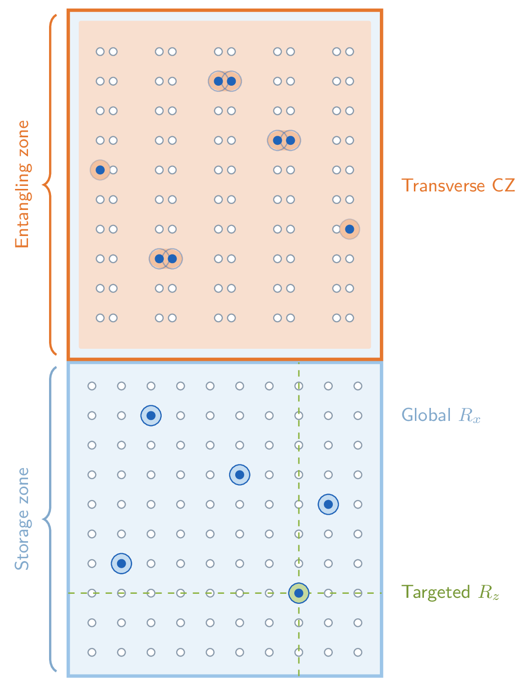
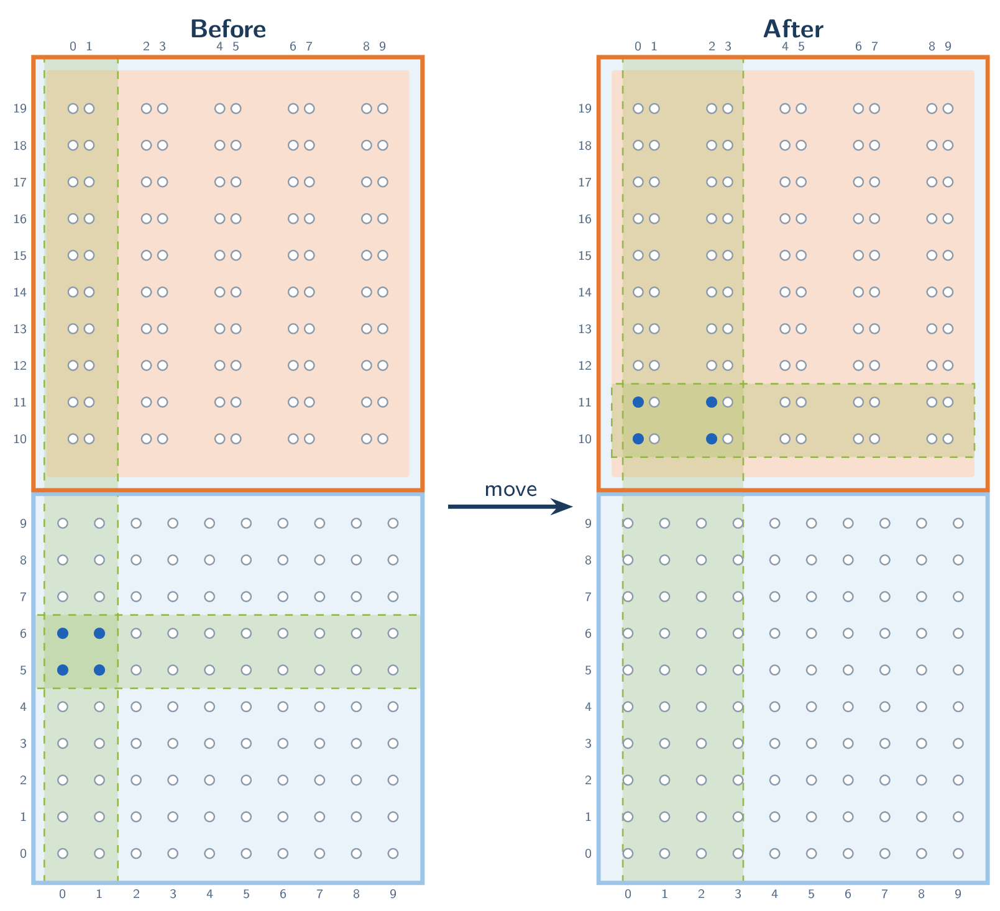
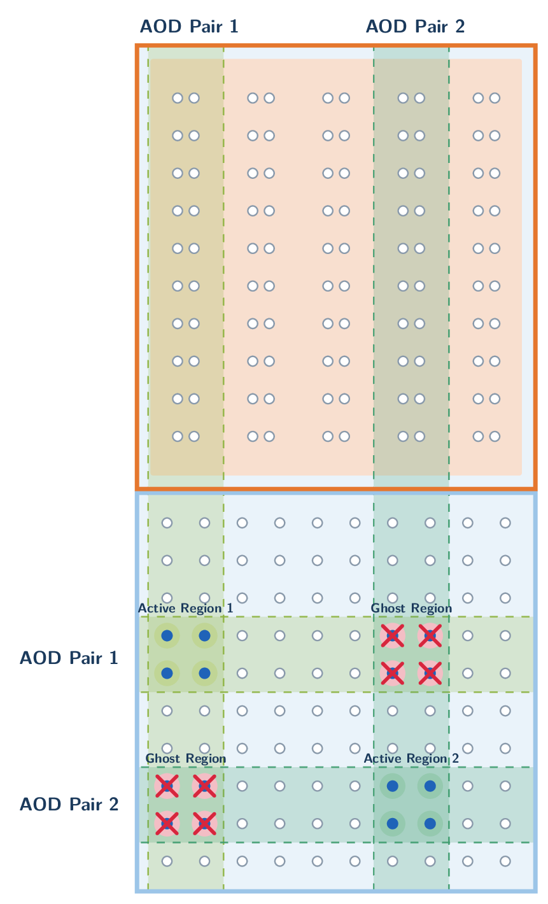
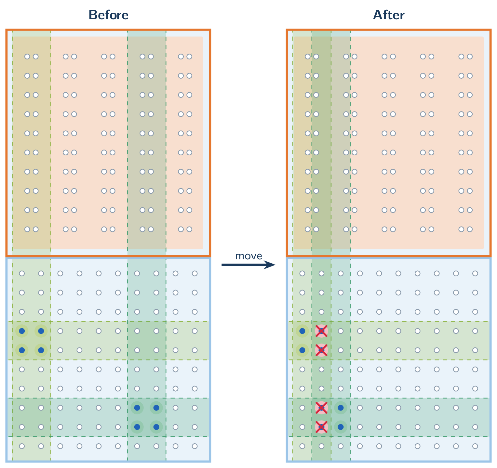

# planqc | PushQuantum 2026

> planqc track for PushQuantum Hackathon 2026: Compilation of circuits on Neutral Atom devices.

**Host:** planqc (planqc)  
**Track slug:** `planqc-pushquantum-2026`  
**Visibility:** MEMBERS (isPrivate=True)  
**Dates:** 2026-11-20 → 2026-11-22 (Europe/Berlin)  
**Location:** Garching bei München (Research Campus), Germany · IN_PERSON  
**Reward:** SWAG: Top team wins planqc merch  
**Source:** https://aqora.io/challenges/pushquantum-hackathon-2026/tracks/planqc-pushquantum-2026  
**Captured:** 2026-11-21T11:56:57.635026Z

---

## Purpose

# Purpose

**Why compilation matters.** On a neutral atom machine, the abstract circuit you write is not the circuit that runs. Only global $R_x$, targeted $R_z$ and $CZ$ gates on atoms that sit next to each other in the entangling zone are native. Thus, every abstract gate has to be transpiled onto this gateset and qubits need to be moved between zones based on the required interactions. Moving atoms is usually the slowest operation on the device and a significant source of errors. Two circuits that are equivalent on paper can therefore differ a lot in run time and fidelity, depending on how well their interaction pattern is scheduled and routed. This is what you optimize in this challenge. To make it concrete, we use a small variational algorithm for a logistics problem as an example.

**The toy problem: choosing bus stops.** A city wants to consolidate stops along a bus route. Every neighborhood has exactly two acceptable stops, and keeping stop $i$ incurrs $c_i$ in maintenance costs. Find the cheapest set of stops such that every neighborhood keeps at least one of its two.

Drawing an edge between the two acceptable stops of each neighborhood turns this into a graph problem (a minimum-weight vertex cover).

Our chosen instance has 12 stops and 18 neighborhoods. The graph consists of four triangles, $\{1,2,3\}$, $\{4,5,6\}$, $\{7,8,9\}$, $\{10,11,12\}$, connected by six links: 1–4, 2–7, 3–10, 5–8, 6–11, 9–12.

The unique optimum keeps stops $\{1,2,5,6,7,8,10,12\}$ at cost 14, i.e. it drops one stop per triangle (3, 4, 9, 11), none of them linked to each other. The instance is small enough to be checked by brute force on purpose: the challenge is not to solve it classically, but to run a variational circuit for it efficiently on the device.

*Fig 0: The example instance: every edge is one neighborhood and joins its two acceptable stops, and the table lists the maintenance cost $c_i$ of each stop. Green vertices and highlighted costs mark the stops kept in the optimal solution, and every edge keeps at least one green endpoint.*

**From stops to an Ising model.** A variational algorithm needs the problem as a Hamiltonian on qubits, one per stop. Let $x_i=1$ if stop $i$ is kept and penalize every neighborhood that loses both of its stops:

$$F(x)=\sum_i c_i x_i+P\sum_{(i,j)\in E}(1-x_i)(1-x_j),\qquad P=5>\max_i c_i.$$

The minimum of $F$ is the cheapest valid set of stops. Substituting $x_i=(1-Z_i)/2$, i.e. $Z_i=-1$ for a kept stop, gives $F=(H+146)/4$ with the classical Ising Hamiltonian

$$H=5\sum_{(i,j)\in E}Z_iZ_j+\sum_i(15-2c_i)\,Z_i,$$

which has a $ZZ$ coupling on every neighborhood and a local field on every stop.

**Where compilation comes in.** A variational circuit searches for this minimum. A generic choice is the *hardware-efficient ansatz* (HEA): layers of parametrized single-qubit rotations followed by $CX$ gates between neighboring qubits, without using the problem structure. One layer on $n$ qubits needs only $n-1$ entangling gates, in two rounds of disjoint pairs. On this device, every entangling gate means that two atoms have to meet in the entangling zone for a $CZ$ pulse, while targeted $R_z$ rotations are only available in the storage zone. The number of entangling rounds and the distance the atoms travel between them therefore decide the cost, and pairs that interact in the same round can be moved and pulsed together.

A circuit that follows the problem structure more closely can be better on the abstract level, but this does not make it better on the device. Problem-tailored ansätze are often built on a Max-Cut form of the problem: the local fields become couplings to one extra reference qubit $a$ (with weights $15-2c_i$), so that all 30 terms, 18 neighborhood edges of weight 5 and 12 reference edges, are $ZZ$ interactions. A bitstring $b$ then cuts the graph with weight $W(b)=180-2F(x)$, where $x_i=b_i\oplus b_a$, and the maximum cut ($W^*=152$, reached by&#32;`1100111101010`&#32;and its complement) encodes the same stops. An example is the *imaginary Hamiltonian variational ansatz* (iHVA, [Wang et al., Phys. Rev. A 111, 032612 (2025)](https://doi.org/10.1103/PhysRevA.111.032612)), which places one parametrized two-qubit gate on every Max-Cut edge. Here that is 30 gates (60 $CZ$) per layer. Since the reference qubit has 12 partners and an atom can only partner with one neighbor per pulse, it also needs at least 12 rounds per layer, compared with 2 for an HEA layer. The best circuit in the abstract is therefore not necessarily the best one after compilation, and the metrics below measure the latter.

**Bonus challenge: tailor the ansatz.** The cost function is fixed, the circuit that searches for its minimum, and how you encode the problem into qubits, are yours. We encourage you to design an ansatz that is more expressive than a generic HEA and easier to compile than the obvious one-gate-per-edge circuit, for example:

- Match the hardware. Build entangling layers from interactions the device performs in parallel instead of one gate per problem edge.
- Use the structure of the instance. The graph is made of four tightly connected clusters. Entangling within clusters first keeps atoms close together and movements short.
- Trade expressivity for cost. Global $R_x$ and targeted $R_z$ layers need no movement of their own while the atoms are in storage, so extra parameters there are cheap compared to an additional round of entangling gates.

Please document the encoding and ansatz you choose (see Deliverables).

# PushQuantum Hackathon Challenge

Since the introduction of the zoned architecture for neutral atom quantum computers by Bluvstein et al. There has been an increased interest in how to best exploit the architectural capabilities while adhering to its constraints. However, a clear optimization of the compilation process still remains an open question. In this challenge, we provide a neutral atom device with simplified constraints and a series of circuits to compile.

## Quantum Device Specifications

The setup is a 100 qubit neutral atom quantum machine utilizing a zoned architecture as illustrated in Figure 1.

*Figure 1: Zoned Neutral Atom Architecture*

There are two main zones for this hackathon. The blue zone, known as the storage zone, and the red zone, known as the entangling zone. The diagram also illustrates what native gates are available:

- Targeted $R_z$ rotations, indicated by a green circle, which can affect a single qubit in the storage zone.
- Global $R_x$ rotations, indicated by blue circles, that affect all qubits in both zones. This means that all qubits in both zones in Fig. 1 will experience the $R_x$ gate. [Relaxed to also allow single qubit targetting]
- Two-qubit $CZ$ rotations, indicated by orange ovals, which affect all neighboring qubit pairs in the entangling zone transversally. Single atoms in the entangling zone are excited by this process but, logically, only experience an identity operation.
- Movement operations, which are not visually depicted here, will be described in the next section.

You may assume that the $R_z$ and $R_x$ gates can be implemented with arbitrary angles.

## Move Semantics

*Figure 2: Movement Examples*

Each circle, empty or filled, in Fig. 1 represents a set of spatial light modulators (SLMs) that hold atoms statically in place. Thus, in order to move atoms together or apart or between zones, one requires a pair of orthogonal acousto-optic deflectors (AODs), one vertical and one horizontal. These can pick up and deposit rows or columns of atoms from and to SLM traps. One exemplary movement is shown in Fig. 2 and is described in the following:

A contiguous set of source rows and columns are chosen. In this example, rows (5, 6) and columns (0, 1) are chosen.

The orthogonal AOD pair picks up atoms from the SLM traps in the intersection, we refer to this as the active region of the AOD pair. Each AOD pair has a single contiguous active region. This is highlighted in darker green.

A set of empty destination rows and columns are chosen. In this example, rows (10, 11) and columns (0, 2) are chosen. Note, that depositing an atom into an already filled SLM trap constitutes an invalid move operation.

Ideally, valid movements must also preserve the proportional spacing between atoms, but this will not be enforced for this challenge.

The orthogonal AOD pair shifts to the chosen destination and deposits the carried atoms.

This is encoded as movement of $[(5,6), (0,1)] \rightarrow [(10, 11), (0, 2)]$.

## Movement Constraints

For this problem, we assume that you can utilize multiple pairs of AODs simultaneously to perform parallel movements. However, this comes with three constraints:

- Permuting the rows and columns during a movement is not possible. For example, the following movement given the described architecture is invalid: $[(5,6), (0,1)] \rightarrow [(10, 11), \mathbf{(2, 0)}]$ as the atoms in the initial columns $(0, 1)$ are permuted. More exactly, the order of rows and columns must be preserved.
- During pickup, movement or deposit, the intersection of any simultaneous AOD pairs that is not an active region must be empty of atoms. Such intersections, referred to as ghost regions, are indicated in Fig. 3 with red Xs. Here, the atoms marked in red would also be picked up and likely lost during the movement operation.
- During movement of multiple AOD pairs, the active regions of any AOD pair cannot overlap with any other AOD. An example of one such illegal move is shown in Fig. 4.

Any consecutive move operations that do not violate these constraints can be run simultaneously. For simplicity, we also assume that movement operations are fully atomic (i.e. interleaving pickup, move and deposit operations to ensure that simultaneous movement operations are valid is not possible) and that new movement operations cannot start before the current set of simultaneous movements are completed.

Otherwise, they will be run sequentially as single movements that do not permute column or row indices cannot violate the remaining constraints.

*Figure 3: Example of invalid simultaneous pickup operations.*

*Figure 4: Example of invalid simultaneous movement operations.*

## Initial Atom Placement

For each transpiled circuit, the initial atom placement can be anywhere within the storage zone. For simplicity, we assume that atom loading only occurs during initial placement. You may assume any number of atoms can be used for each compiled circuit, i.e. the usage of additional ancilla or reduced number of atoms to simplify transpilation are both allowed. You may also ignore the effects of atom loss during operations.

## Deliverables

### What you receive

- A custom qiskit `QuantumInstruction` that defines a Move operation as defined in this document, named move.py.
- A spec file `architectures/default.json` that encodes the zones and coordinates of the SLM traps per Fig. 1 and the corresponding parsing method in architecture.py.
- A template file template.py with the compiler function signature that must be implemented.
- A set of circuits for the Hardware-Efficient Ansatz implementation

### What we want

A function (or series thereof) that produces a qiskit `QuantumCircuit` object that can be used to solve the optimization problem. Please clearly document the encoding used for this process.

An implementation of `compile_circuit` that accepts the above `QuantumCircuit` object and the parsed spec file and produces an initial atom placement and a transpiled `QuantumCircuit`.

The final transpiled circuit must:

Only consist of the gate set described in [Quantum Device Specifications](#quantum-device-specifications).

- Only consist of valid move operations.
- Be equivalent up to a phase shift to the input circuit.

The metrics to rank the compilation step ordered by importance:

- Adherence to strict constraints in [Movement Constraints](#movement-constraints).
- Total cartesian distance of moved atoms considering parallelism. Only the longest traveled distance is considered for each set of movement operations that can be run in parallel.
- Circuit depth (excluding movement operations).
- (bonus): Find an efficient circuit ansatz to represent the Hamiltonian.

---

## About / Overview

## planqc

Participants will implement a movement / routing algorithm for a simple two-zoned neutral atom computing device based on the infrastructure present in:

[Logical quantum processor based on reconfigurable atom arrays | Nature](https://www.nature.com/articles/s41586-023-06927-3)

In the introduced architecture, only certain operations can be run in each zone. The task involves, given an input quantum circuit, to map it to the native gate-set of the provided architecture and then provide a routing / placement algorithm to move atoms between the two zones and ensure that every operation runs in the correct region. The goal is to then minimize the total movement and the effective total run-time of the output circuit.

An overview of recent techniques and algorithms can be found in the following research papers:

[Reuse-Aware Compilation for Zoned Quantum Architectures Based on Neutral Atoms | IEEE Conference Publication | IEEE Xplore](https://ieeexplore.ieee.org/document/10946298)

[ZAP: Zoned Architecture and Performant Compiler for Field-Programmable Atom Array | IEEE Journals & Magazine | IEEE Xplore](https://ieeexplore.ieee.org/document/11535023)

### Track links

- [Discussion](https://aqora.io/challenges/pushquantum-hackathon-2026/tracks/planqc-pushquantum-2026/discussions): Ask technical questions.
- [Submissions](https://aqora.io/challenges/pushquantum-hackathon-2026/tracks/planqc-pushquantum-2026/submission): Read the submission instructions when they are available.
- [Track rules](https://aqora.io/challenges/pushquantum-hackathon-2026/tracks/planqc-pushquantum-2026/rules): Check the provider rules when they are available.
- [Event agenda](https://aqora.io/challenges/pushquantum-hackathon-2026/agenda): Check the session times.
- [Hackathon guide](https://aqora.io/challenges/pushquantum-hackathon-2026): Return to the event links.

planqc will confirm the task, resources, scoring method, and submission deadline.

---

## Getting started

1. Attend the Friday kick-off from 18:00 to 19:45 CET.
2. Read the challenge brief when it is available.
3. Follow the provider instructions for tools and access.
4. Ask technical questions in the [track discussion](https://aqora.io/challenges/pushquantum-hackathon-2026/tracks/planqc-pushquantum-2026/discussions).

The provider has not confirmed the submission deadline.

---

## Event context

PushQuantum Hackathon 2026 — see [`event.md`](event.md) and [`event-agenda.md`](event-agenda.md).

## Reference papers

Downloaded to [`references/`](references/):

- [arXiv:2312.03982](https://arxiv.org/abs/2312.03982) — Bluvstein et al., *Logical quantum processor based on reconfigurable atom arrays* (Nature 2024)
- [arXiv:2411.11784](https://arxiv.org/abs/2411.11784) — *Reuse-Aware Compilation for Zoned Quantum Architectures Based on Neutral Atoms*
- [arXiv:2411.14037](https://arxiv.org/abs/2411.14037) — *ZAP: Zoned Architecture and Performant Compiler for Field Programmable Atom Array*
- [arXiv:2408.09083](https://arxiv.org/abs/2408.09083) — *Imaginary Hamiltonian variational ansatz for combinatorial optimization problems*

## Starter kit, benchmarks and scoring (found in public workspaces)

- **Template workspace:** [`planqc/pushquantum-2026-template`](https://aqora.io/planqc/pushquantum-2026-template/versions/0.0.0) v0.0.0 — downloaded to [`template/`](template/). It contains `readme.py`, a marimo notebook with:
  - `default_spec()`, `Architecture`, `Zone`, `load_spec`, `parse_zone`;
  - the custom Qiskit `Move` instruction and `QuantumCircuit.move(...)`;
  - the `compile_circuit(circuit, architecture_spec)` entry point to implement;
  - a live HEA benchmark cell.
- **Metric dataset:** [`planqc/pushquantum-2026-metric-hea`](https://aqora.io/datasets/planqc/pushquantum-2026-metric-hea) v0.1.0 — 8 QASM circuits (12/20/50 qubits, HEA p=1/3 and iHVA stagger p=1/3), extracted to [`dataset-hea/qasm/`](dataset-hea/qasm/).
- **Leaderboard + full validator:** [`planqc/pushquantum-2026-leaderboard`](https://aqora.io/planqc/pushquantum-2026-leaderboard/versions/0.0.0) v0.0.0 — downloaded to [`leaderboard/`](leaderboard/). It contains the complete `pushquantum_validator` package, 36 metric benchmarks, 13 sanity benchmarks, `naive_baseline.json`, and the scoring notebook.

## Status / gaps on the platform

- The *competition* object still has empty `datasets` / `templates` / `useCase`; the real resources are published as standalone public workspaces (above).
- No track discussion topics, track rules text is empty, submission deadline not set, no submissions yet.
- Reward: top team wins planqc merch.

## Files

- `platform-data.json` — raw GraphQL response (competition, stage, rules, rewards, event)
- `images/` — figures from the brief plus banner/thumbnail (`fig0`–`fig4`)
- `links.md` — every external link found in the brief
- `event.md` / `event-agenda.md` — event guide and full agenda
- `template/` — starter marimo notebook from the planqc template workspace
- `dataset-hea/` — `heas.parquet` plus the 8 extracted benchmark QASM files
- `leaderboard/` — leaderboard notebook and the complete `pushquantum_validator` source + benchmarks
- `NOTES-scoring.md` — reverse-engineered scoring/validator summary
